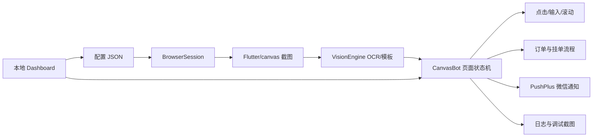

# NO 钱包自动化脚本：功能模块说明

## 1. 总体架构



页面处理采用“两级路由”：

1. `modal_handlers()` 先处理模态框。交易通知、订单异常、取消确认和支付密码弹窗拥有最高优先级，会中断当前页面动作，处理完成或等待后才回到页面流程。
2. `handle_content_page()` 再处理普通页面。登录页等待手动登录，搬砖页负责余额和挂单，订单页负责跟踪与刷新，变现表单负责填写和提交，余额不足页面负责返回搬砖页。

这样可以避免在弹窗出现时继续执行底层页面动作，也避免把“变现余额不足 10”的空页面误判为可填写表单。

## 2. 模块清单

### 2.1 `canvas_bot/__main__.py`

项目主入口和自动化核心，包含 CLI 子命令：

- `doctor`：检查 Playwright、OpenCV、RapidOCR、Chrome 和 profile。
- `login`：打开浏览器，等待用户手动登录并保存 Cookie。
- `snapshot`：截图、执行 OCR、输出页面诊断信息。
- `run`：启动自动化状态机。
- `dashboard`：启动本地控制台。

### 2.2 `VisionEngine`

视觉识别层，负责：

- 调用 RapidOCR 读取 Flutter/canvas 截图中的中文和数字。
- 规范化 OCR 文本，按关键词寻找按钮、标签、订单状态和收款卡片。
- 使用 `templates/` 下的模板图辅助识别。
- 在操作前后保存带 OCR 框的调试截图。

由于目标页面主要是 canvas，不依赖页面 DOM 中的业务文字。

### 2.3 `BrowserSession`

浏览器控制层，负责：

- 启动 Playwright 和 Chrome。
- 使用独立 managed profile 保存登录状态。
- 识别真正的 Flutter 内容区域，避免把浏览器空白区当作应用页面。
- 执行点击、滚动、拖动、刷新和截图。
- 对数字输入框使用键盘事件逐字输入，兼容 Flutter canvas 输入框。

### 2.4 `CanvasBot` 页面识别状态机

脚本每轮执行“截图 → OCR → 页面分类 → 安全动作”的循环。当前支持识别：

- 登录/注册页
- 导航页
- 搬砖页
- 变现表单
- 交易通知弹窗
- 接单确认弹窗
- 订单列表和订单详情
- 待付款状态
- 取消确认弹窗
- 支付密码弹窗
- 未知/加载页

登录页和未知加载页有不同处理：登录页等待手动操作，未知页达到刷新阈值后才刷新，避免识别不到时连续误操作。

### 2.5 自动挂单模块

挂单流程：

1. 进入顶部“搬砖”页面。
2. 识别“开始搬砖”。
3. 识别当前搬砖余额。
4. 填写变现金额、最小限额和最大限额。
5. OCR 选择配置中的收款卡片。
6. 点击底部确认按钮。
7. 等待页面二次确认。
8. 识别支付密码弹窗并输入密码。
9. 等待页面返回搬砖页，才记录为挂单成功。

金额或限额视觉校验失败时会暂停本次挂单，不会继续点击确认。

### 2.6 多挂单和余额管理模块

开启 `multi_order.enabled` 后：

- 按当前余额计算本次允许的挂单金额。
- 余额不足配置金额时点击页面“全部”，使用实际可用余额。
- 余额低于 `limit_min` 时停止新增挂单。
- 可以按关键词列表循环选择不同收款卡。
- `adopt_existing_pending_orders` 开启后，启动时接管已有挂单并从本次启动时间重新计时。

### 2.7 自动接单模块

识别到交易通知后：

1. 发送一次 PushPlus 交易通知。
2. 识别并点击“同意交易/同意接单”等安全关键词。
3. 等待确认状态和订单页面。
4. 对订单详情、订单列表和待付款状态进行后续跟踪。

脚本不会对包含“确认到账”“确认放行”等危险词的按钮执行自动点击。

### 2.8 超时取消与自动重挂模块

多挂单模式下，脚本按先进先出跟踪挂单：

- 到达 `repost_delay_sec` 后向下扫描活动订单。
- 只有识别到取消按钮下方存在已完成/已取消历史记录，才确认目标位于活动订单尾部。
- 找到取消确认弹窗后才点击确认。
- 取消成功且余额恢复后，继续新增挂单。
- 达到 `cancel_search_max_steps` 仍无法确认目标时，只保存调试图并暂停，不猜测坐标。

### 2.9 支付密码模块

支持两种密码来源：

1. 控制台运行中的内存密码：推荐方式，可在支付弹窗出现后输入或修改。
2. `QJD67_PAY_PASSWORD` 环境变量：适合命令行直接运行。

密码只在识别到支付密码弹窗时读取。输入方式支持键盘输入；如果页面变成随机数字键盘，则使用 `points.keypad` 中的比例坐标逐位点击。

### 2.10 `PushPlusNotifier`

通知模块通过 PushPlus HTTP API 使用微信通道发送文本消息：

- Token 来自 `QJD67_PUSHPLUS_TOKEN`。
- Windows 下同时兼容读取当前用户环境变量注册表值。
- 通知失败只记录日志，不中断自动化主循环。
- 通过事件名去重，避免同一轮运行重复推送。

当前通知内容以 `canvas_bot/__main__.py` 中的事件分支为准；启动通知已关闭。

### 2.11 `canvas_bot/dashboard.py`

本地控制台模块，负责：

- 提供 `127.0.0.1:8765` 网页界面。
- 修改并校验可编辑配置。
- 保存配置后原子替换 JSON，避免写入半截文件。
- 启动/停止由控制台创建的脚本进程。
- 将运行日志显示在网页中。
- 展示最近 12 张调试截图。
- 在内存中保存控制台支付密码。
- 启动前清理上一轮截图，保留运行日志文件句柄安全性。

## 3. 主要配置模块

| 配置区域 | 关键字段 | 作用 |
|---|---|---|
| `browser_profile` | `mode`, `system_user_data_dir`, `profile_directory` | 浏览器登录状态和 profile 来源 |
| `visual_app_rect` | `enabled`, `max_dom_width` | 定位 Flutter 内容区域 |
| `unknown_page_refresh` | `consecutive_scans`, `cooldown_sec` | 未知页面刷新阈值 |
| `cancel_flow` | `confirm_delay_sec`, `confirm_timeout_sec` | 取消确认节奏 |
| `submit_flow` | `secondary_confirm_*`, `password_timeout_sec` | 挂单提交和密码弹窗等待 |
| `payment` | `keywords`, `ocr_attempts` | 收款卡识别关键词和重试次数 |
| `multi_order` | `enabled`, `adopt_existing_pending_orders`, `cancel_search_max_steps` | 多挂单、接管和取消策略 |
| `password` | `env`, `input_mode`, `confirm_after_input` | 支付密码来源和输入方式 |
| `texts` | 页面文字关键词数组 | OCR 页面识别词库 |
| `points` | 比例坐标 | 必要时的页面区域定位和数字键盘坐标 |
| `debug` | `dir`, `save_on_action`, `draw_ocr` | 调试截图保存策略 |

## 4. 安全边界

- 不依赖不可验证的固定坐标完成关键操作。
- 金额、限额、收款卡和状态尽量通过 OCR 或模板二次确认。
- 未识别到关键状态时暂停，不自动猜测。
- 危险资金确认词会阻止自动点击。
- 支付密码不写入 JSON、日志或 Git。
- 控制台仅绑定回环地址，不提供公网访问。
- 浏览器关闭后脚本停止，不持续输出无意义错误。

## 5. 测试与验证

修改代码后建议执行：

```powershell
uv run python -m compileall -q canvas_bot
uv run pytest -q
uv run qjd67-canvas-bot doctor --config configs/qjd67.json
```

运行中验证优先看：

- `debug-screenshots/dashboard-bot.log`
- 控制台运行状态和 PID
- 调试截图中的 OCR 框
- PushPlus 日志中的 `code: 200`
